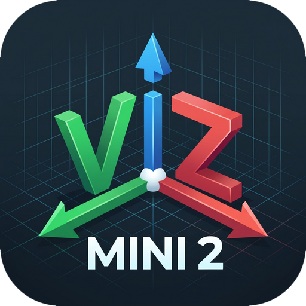
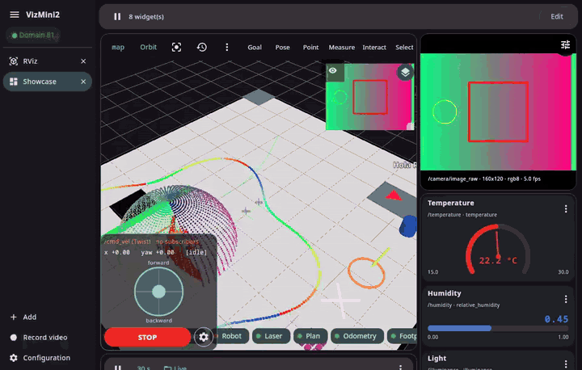
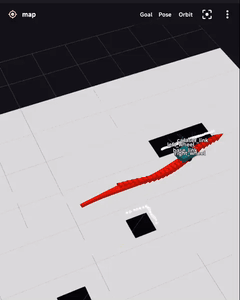
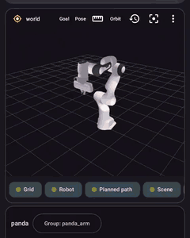
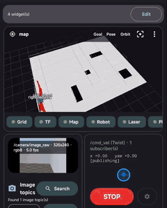
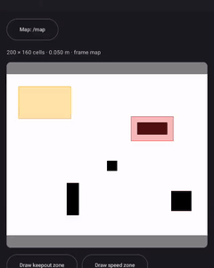

<p align="center">
  
</p>

# VizMini2

[](https://github.com/VizMini2/VizMini2/actions/workflows/ci.yml)
[](LICENSE)
[](https://vizmini2.github.io)
<br>
[](https://vizmini2.github.io/help/requirements.html)
[](https://vizmini2.github.io/config/network.html)
[](https://vizmini2.github.io/getting-started/install.html)
[](https://vizmini2.github.io/getting-started/desktop.html)
[](https://vizmini2.github.io/getting-started/desktop.html#on-windows)

<p align="center">
  <a href="https://play.google.com/store/apps/details?id=com.juancams.vizmini2"></a>
  <a href="https://github.com/VizMini2/VizMini2/releases/latest"></a>
  <a href="https://github.com/VizMini2/VizMini2/releases/latest"></a>
  <a href="https://vizmini2.github.io/"></a>
</p>

<p align="center">
  <a href="https://vizmini2.github.io/getting-started/demo.html">Try the demo</a> ·
  <a href="https://vizmini2.github.io/getting-started/install.html">Install guide</a> ·
  <a href="https://vizmini2.github.io/changelog.html">Changelog</a> ·
  <a href="https://github.com/sponsors/Juancams">Sponsor</a>
</p>

ROS 2 visualization and control on Android and on the desktop, from one code base: a 3D view like RViz (TF, robot
model, maps, laser, point clouds, cameras, markers, interactive markers, Nav2 waypoints, MoveIt planning...),
dashboards, plots, teleop, topics, parameters, lifecycle, ros2_control controllers, PlanSys2 plans as they run, map
tools for Nav2 (saving, SLAM Toolbox, costmaps, keepout and speed zones), alerts on any topic, H.264/H.265 video
topics, screen recording, bags and more. It talks DDS directly (Fast DDS through jros2), and also Zenoh and foxglove_bridge. It imports and exports
RViz 2 files (`.rviz`) and the panel and plot layouts of other ROS tools.

<p align="center">
  
</p>

| 3D view | MoveIt | Dashboard | Map tools |
|:---:|:---:|:---:|:---:|
|  |  |  |  |

## Install

| Platform | How |
| --- | --- |
| **Android** 8.0 or newer | From [Google Play](https://play.google.com/store/apps/details?id=com.juancams.vizmini2), or the `.apk` from the [latest release](https://github.com/VizMini2/VizMini2/releases/latest) (`universal` fits every phone). Each one updates from where it came from. |
| **Windows** 10 or 11 | The `.msi` from the [latest release](https://github.com/VizMini2/VizMini2/releases/latest): installed for your user, no administrator needed. Or the `.zip`, without installing. |
| **Ubuntu** 20.04 or newer | With apt, from VizMini2's repository ([three commands](https://vizmini2.github.io/getting-started/desktop.html)), or the `.deb` from the [latest release](https://github.com/VizMini2/VizMini2/releases/latest): `sudo apt install ./vizmini2_*_amd64.deb` (it also adds the repository, so `apt upgrade` brings the new versions). Or the `.tar.gz`, without installing. |
| **As a ROS 2 package** (Linux) | Built from this repository: see [Build your own version](#build-your-own-version). |

For H.264/H.265 video topics and recording the window on the desktop, install `ffmpeg` (`sudo apt install ffmpeg`,
or `winget install ffmpeg` on Windows). The [installation guide](https://vizmini2.github.io/getting-started/install.html)
has every step.

## First steps

- **No robot at hand?** Turn on the [demo mode](https://vizmini2.github.io/getting-started/demo.html): a simulated
  robot inside the app, with a laser, a map, a camera and services to try every tab.
- **Your robot**: the phone or the PC on the same network as the robot and the same `ROS_DOMAIN_ID`, and its topics
  show up. If they do not, see [connecting to a robot](https://vizmini2.github.io/getting-started/connect.html) and
  [troubleshooting](https://vizmini2.github.io/help/troubleshooting.html).
- **Coming from RViz?** Import your `.rviz` file and keep your displays.

The [user manual](https://vizmini2.github.io) (English and Spanish) explains every tab.

## Build your own version

You need **JDK 21** and the **Android SDK** (Android Studio brings both; set `sdk.dir` in `local.properties` or
`ANDROID_HOME`). No sudo or Docker is needed for any script. The first build also downloads the prebuilt native
libraries (Fast DDS, Filament: about 37 MB) from the repository's
[`prebuilt` release](https://github.com/VizMini2/VizMini2/releases/tag/prebuilt) (see [tools/prebuilt](tools/prebuilt/README.md)).

```bash
git clone https://github.com/VizMini2/VizMini2.git
cd VizMini2
```

**Android** (a debug build: it has the same package name as the released app but another signature, so uninstall
that one first):

```bash
./gradlew installDirectDebug        # build and install it on the connected phone (USB debugging on)
./gradlew assembleDirectDebug       # or just the APKs, in app/build/outputs/apk/direct/debug/
```

**Desktop** (Linux or Windows):

```bash
./gradlew :desktopApp:run           # run it from the sources
./gradlew :desktopApp:packageDeb    # the .deb (on Linux), in desktopApp/build/compose/binaries/main/deb/
./gradlew :desktopApp:packageMsi    # the .msi (on Windows, with a JDK 21 that has jpackage)
```

**As a ROS 2 package** (Linux; it builds the desktop app with Gradle and installs it in the workspace):

```bash
mkdir -p ~/vizmini2_ws/src && cd ~/vizmini2_ws/src
git clone https://github.com/VizMini2/VizMini2.git
cd .. && colcon build --packages-select vizmini2
source install/setup.bash
ros2 run vizmini2 vizmini2
```

More in [Building and testing](https://vizmini2.github.io/developers/building.html).

## Testing

```bash
./gradlew :core:jvmTest testDirectDebugUnitTest lintDirectDebug   # unit tests and lint
tools/e2e/run.sh                                                   # the desktop app against real ROS 2 servers
tools/e2e/android_device_tests.sh                                  # on a phone or emulator, with the demo robot
tools/pc_tests.sh -b                                               # a phone against servers on this PC
tools/compat/try-desktop.sh 22.04 [vizmini2_1.0.0_amd64.deb]       # the app (or the .deb) on another Ubuntu
```

`tools/e2e/run.sh` needs ROS 2 on the PC: it starts a fake robot, Nav2, MoveIt, ros2_control and more, runs the tests
and stops them. `python3 tools/fake_robot.py` alone is handy to try the app by hand. The CI runs all of this, except
`tools/pc_tests.sh` (it needs a real phone), on pushes to `main` and on pull requests.

## Documentation

The user manual is in `docs/` (Sphinx, English in `docs/en/`, Spanish in `docs/es/`), and the API reference comes
from the code (Dokka). To build them and look at them before pushing:

```bash
python3 -m pip install sphinx sphinx-rtd-theme myst-parser
docs/build.sh                                         # the manual in docs/_build/site
python3 -m http.server -d docs/_build/site 8000       # open http://localhost:8000 (Spanish: /es/)
./gradlew dokkaGenerate                               # the API reference in build/dokka/html/index.html
```

The website, [vizmini2.github.io](https://vizmini2.github.io), is updated on its own when a release is published.

## Repository

| Folder | What it is |
| --- | --- |
| `core/` | Shared logic (ROS connection, dynamic messages, models, Nav2/MoveIt clients...), plain JVM, unit tested |
| `ui/`, `rviz3d/` | Shared Compose screens and the Filament 3D view, compiled by both apps |
| `app/` | The Android app |
| `desktopApp/` | The desktop app (Compose for Desktop) and its end-to-end tests |
| `ros/vizmini2/` | The ROS 2 package that builds and starts the desktop app |
| `tools/` | Test servers (fake robot, fake Nav2, MoveIt with the Panda...), CI scripts and build helpers |
| `tools/prebuilt/` | The list of the prebuilt native libraries the build downloads, and the scripts to publish rebuilt ones |
| `docs/` | User manual |

## Releases

`tools/release/start.sh 1.2.3` creates the draft release in your name and pushes the `v1.2.3` tag, which builds
every file of the release on GitHub Actions (APKs, `.deb`, `.tar.gz`, `.msi`, `.zip`, manual; the
`.deb` and the `.msi` are also installed and started) and uploads them to that draft, to publish by hand. The Google Play
`.aab` is kept as a workflow artifact. The steps, the version checks and the signing
keys are in [Releases and CI/CD](https://vizmini2.github.io/developers/releases.html).

## Contributing

Bug reports, ideas and pull requests are welcome: see [CONTRIBUTING.md](CONTRIBUTING.md).

## License

Copyright (C) 2025-2026 Juan Carlos Manzanares Serrano <jc.manzanares.serrano@gmail.com>

VizMini2 is free software under the **Apache License 2.0** ([LICENSE](LICENSE), [NOTICE](NOTICE)). The name
"VizMini2" and its logo are not covered by the license: forks must use their own. Contributions are welcome under the
same license; see [CONTRIBUTING.md](CONTRIBUTING.md).
